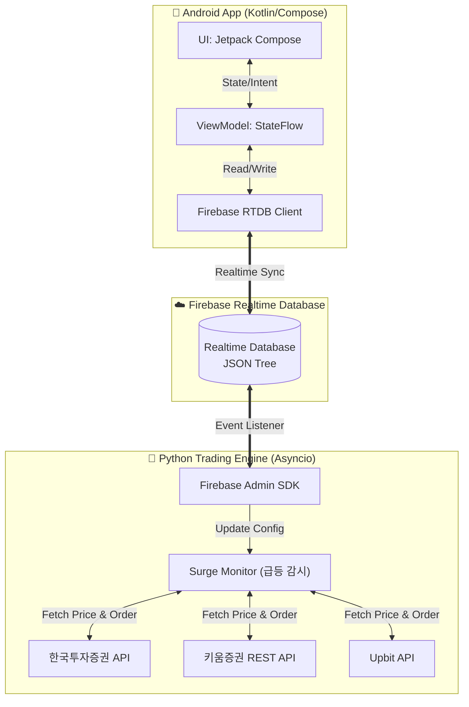

# MyAutoTrading 아키텍처 및 세부 구조 명세 (Architecture & Features)

이 문서는 개인용 주식/가상화폐 자동매매 시스템의 전체 아키텍처와 세부 데이터 흐름, 핵심 로직을 설명합니다. **향후 시스템 수정 시 본 문서를 항상 최신 상태로 유지해야 합니다.**

---

## 1. 시스템 전체 아키텍처 (System Architecture)

본 시스템은 **Android App (클라이언트)** 과 **Python Engine (백엔드 서버)** 이 완전히 분리되어 있으며, 그 사이를 **Firebase Realtime Database**가 중계하는 구조를 가집니다.

### 1.1 핵심 데이터 흐름 (Data Flow)
1. **설정 변경 (App ➡️ Firebase ➡️ Python):** 
   - 사용자가 앱에서 '감시 종목 추가', '매수 조건(시간/퍼센트/수량) 변경', '자동매매 ON/OFF' 버튼을 누릅니다.
   - 앱은 해당 내용을 JSON 포맷으로 직렬화하여 Firebase에 덮어씁니다.
   - Python 엔진은 Firebase의 `db.reference('/settings').listen()` 리스너를 통해 변경 이벤트를 실시간(0.1초 이내)으로 수신하고 내부 설정값(`user_session.py`)을 갱신합니다.
2. **시세 및 계좌 반영 (Python ➡️ Firebase ➡️ App):**
   - Python 엔진의 백그라운드 태스크가 업비트/한국투자증권 API를 지속적으로 호출하여 현재 가격, 총 자산, 보유 주식 수 등을 가져옵니다.
   - 주기적으로 Firebase의 `/status` 경로에 덮어씁니다.
   - Android 앱은 `/status` 경로의 `addValueEventListener`를 통해 상태를 즉시 넘겨받아 화면(Compose)을 다시 그립니다(Recomposition).

---

## 2. 주요 기능 명세 (Features)

### 2.1 다중 급등주 감시 및 매매 (Surge Trading Monitor)
- **개념:** 특정 종목이 `T초` 동안 `P%` 이상 급등했을 때, 봇이 즉시 지정된 수량(`Q`)만큼 시장가(또는 지정가)로 매수하는 기능입니다.
- **다중 감시 지원:** 한 종목(예: 비트코인)에 대해 `[60초/3%/0.01개]`, `[10초/1%/0.05개]` 등 여러 개의 조건(Rule)을 동시에 걸어둘 수 있습니다.
- **연속 매수 방지 (Cooldown):** 급등이 연속으로 일어날 때 수량이 중복해서 매수되는 것을 방지하기 위해, 한 번 매수가 체결되면 해당 감시 조건은 일정 시간(또는 일시정지 상태) 동안 쿨다운에 들어갑니다.

### 2.2 수동 주문 (Manual Ordering)
- 앱에서 버튼을 눌러 즉각적으로 매수/매도/손절 주문을 서버로 쏘아 올립니다.
- Firebase의 `/commands` 경로에 주문 데이터(종목, 가격, 수량, 종류)가 Push되며, Python 서버가 이 경로를 리스닝하다가 새로운 명령이 들어오면 증권사 API를 통해 실제 주문을 실행하고 로그를 남긴 뒤 해당 명령을 데이터베이스에서 삭제(소모)합니다.

### 2.3 장전 시간외 매수 주문예약 관리 (Pre-market Order Reservation)
- **개념:** 정규장 개시 전 또는 시간외 매수를 위해 사용자가 지정한 시간(예: 08:30)에 특정 종목 매수 주문을 자동으로 전송하는 스케줄링 시스템입니다.
- **아키텍처:** 클라이언트가 `/reservations` 경로에 예약 정보를 저장하면, 엔진 내부의 `ReservationManager`(`engine/reservation_manager.py`)가 10초 주기로 도달 여부를 감시하여 지정 시간에 증권사 매수 주문 API를 실행합니다.
- **예약 취소 로직:** 앱에서 예약 삭제 시 DB 대기열 및 메모리에서 즉시 소멸되나, 이미 증권사로 전송 완료된 거래소 체결 대기 주문은 취소되지 않도록 명확한 책임 분리가 되어 있습니다.

### 2.4 라오어 무한매수법 대시보드 및 실시간 잔고 동기화 (Laore Dashboard & Balance Sync)
- **평단가 vs 현재가 비교:** `MainActivity.kt`의 무한매수 카드 레이아웃에 실제 보유 평단가와 시장 실시간 현재가를 나란히 배치하여 즉각적인 손익 및 단가 비교를 제공합니다.
- **실계좌 잔고 동기화:** `user_session.py`의 `_run_laore_schedule` 루프가 실행될 때 국내 주식 및 코인 계좌의 실잔고(`get_balance`)를 1:1로 조회하여 `laore_status`의 평단가와 보유수량을 실제 계좌 잔고 데이터와 동기화합니다.

---

## 3. 폴더 및 파일 구조 (Directory Structure)

### 3.1 Android App (`AutoTradingApp/`)
- **UI 계층 (`MainActivity.kt` 등):** Jetpack Compose로 전면 작성되어 있습니다. `StockTradingScreen`, `CryptoTradingScreen` 등의 컴포저블(Composable) 함수들로 화면이 구성됩니다.
- **상태 관리 (`TradingViewModel.kt`):** `MutableStateFlow`를 이용해 화면의 상태를 관리하고, 사용자의 입력을 받아 Firebase 저장 로직을 호출합니다.
- **데이터 모델 (`TradingModels.kt`):** Firebase와 통신하기 위한 데이터 클래스들이 정의되어 있습니다. Kotlin Serialization이나 Gson 등의 역할을 직접 담당합니다. (예: `SurgeTradingConfig`, `StockStatus` 등)

### 3.2 Python Engine (`py-my-auto-trading/`)
- **`my-auto-trading.py` (엔트리 포인트):** 메인 실행 파일이며, 로거(Logger) 세팅 및 모든 백그라운드 루프(asyncio.gather)를 실행시킵니다.
- **`engine/user_manager.py`:** 다중 사용자 세션을 관리합니다. Firebase의 `users` 경로를 리스닝하여 사용자별 주식/코인 세션을 자동으로 생성하고 파괴합니다. 하위 경로 삭제 시 세션이 잘못 종료되지 않도록 보호 로직이 포함되어 있습니다.
- **`engine/user_session.py`:** Firebase와의 통신을 전담하며, 상태(Status)를 업데이트하거나 앱에서 넘어오는 명령(Commands)과 설정(Settings)을 콜백으로 받아 처리합니다.
- **`engine/reservation_manager.py`:** 장전 시간외 매수 주문예약 데이터를 감시하고 도달 시점에 자동 매수 주문을 발주하는 스케줄러 모듈입니다.
- **`engine/etf_analyzer.py`:** 미국/국내 대표 ETF(TIGER 미국테크TOP10 등) 구성 종목 및 비중 정보를 분석하고 크롤링/가공하는 데이터 모듈입니다.
- **`brokers/kis_broker.py`:** 한국투자증권(KIS) REST API 래퍼. 토큰 캐싱(`.kis_token_*.json`)을 지원하여 계좌 전환 시 재인증 지연을 방지합니다.
- **`brokers/kiwoom_broker.py`:** 키움증권 REST API 래퍼. 실전/모의 투자 도메인 자동 분기(`api.kiwoom.com` / `mockapi.kiwoom.com`), 잔고조회(`kt00004`, `kt00018`), 주문(`kt10000`, `kt10001`), 웹소켓 실시간 시세(`0B`) 지원.
- **`brokers/upbit_broker.py`:** Upbit 코인 거래소 API 래퍼. 웹소켓을 통한 실시간 체결가 수신을 지원합니다.
- **`models/schemas.py`:** Python 측 데이터 모델 클래스들(Pydantic 또는 Dataclass)이 정의되어 있으며, Android의 `TradingModels.kt`와 구조가 1:1로 매칭되어야 합니다.

### 3.3 배포 및 운영 스크립트
- **`deploy.bat`:** 모든 파이썬 소스를 Oracle Cloud 서버에 업로드하고 엔진을 재시작하는 일괄 배포 스크립트.
- **`server.bat`:** 서버 관리 통합 스크립트 (`deploy`, `upload`, `restart`, `log`, `ssh`, `status` 서브커맨드 지원).

---

## 4. 지원 증권사/거래소

| 증권사/거래소 | 자산 유형 | 실전/모의 | API 방식 |
|---|---|---|---|
| 한국투자증권 (KIS) | 국내주식, 해외주식 | 실전 + 모의 | REST + WebSocket |
| 키움증권 | 국내주식 | 실전 + 모의 | REST + WebSocket |
| 업비트 (Upbit) | 가상화폐 | 실전 | REST + WebSocket |

---

## 5. 향후 확장 및 유지보수 가이드
- **새로운 증권사 추가 시:** `brokers/base_broker.py`의 `BaseBroker` 추상 클래스를 상속하여 새 브로커를 구현하고, `engine/user_session.py`의 `_setup_broker()`에 분기 로직을 추가합니다.
- **새로운 설정 필드 추가 시:** 안드로이드의 `TradingModels.kt`와 파이썬의 `schemas.py` 양쪽에 동시에 새로운 변수(Property)를 추가해야 Firebase 직렬화/역직렬화 시 에러가 나지 않습니다.
- **토큰 캐싱:** KIS와 키움증권 모두 Access Token을 로컬 파일에 캐싱합니다. 계좌 전환 시 불필요한 재인증(1분+ 지연)을 방지하기 위한 핵심 최적화입니다.
- **키 관리:** 절대 GitHub나 외부에 `keys.json`, `google-services.json`의 원본 데이터를 올리지 마세요. 템플릿 파일 구조만 유지합니다.
